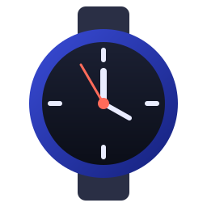

<p align="center">
  
</p>

<h1 align="center">WF-Studio for Linux</h1>

<p align="center">
  Run Samsung's <b>Galaxy Watch Face Studio</b> natively on Linux.<br>
  AppImage and Flatpak · no Wine · no Bottles · no VM
</p>

> **Unofficial community project.** WF-Studio for Linux is not affiliated with, endorsed by or
> supported by Samsung. *Galaxy Watch Face Studio* is proprietary software and a trademark of
> Samsung Electronics. It is **not included** in this project, and WF-Studio for Linux never
> downloads it on its own: you download the installer yourself from Samsung's website, in your
> browser, accepting Samsung's license there, and then choose the file.

---

## Features

- **Native, not emulated.** Watch Face Studio's own code runs on a native Linux Electron runtime.
  There is no Wine translation layer, so it behaves like the Windows version.
- **Full toolchain.** Watch face preview, **Publish** (signed `.aab`) and **Run on Device** use
  native Linux builds of adb, aapt2, apksigner and a JDK.
- **You stay in control.** No automatic downloads. You download the official installer from
  Samsung yourself; WF-Studio for Linux **verifies Samsung's digital signature** before
  installing anything, so a manipulated or fake installer is rejected.
- **Update notifications.** Samsung itself has no auto-update. WF-Studio for Linux tells you
  when a new version is out and installs it from the file you downloaded, keeping the previous
  version as a fallback.
- **Boot screen and WF-Studio Settings.** A short boot screen checks the tools and looks for
  updates; the settings app handles display/GPU tweaks, start-menu entry and desktop shortcut,
  updates, rollback and resetting the installation.
- **AppImage and Flatpak**, built reproducibly from pinned, checksum-verified components.

Tested with Watch Face Studio **1.9.9**. Want to know how it works? See
**[How this application works](docs/HOW-IT-WORKS.md)**.

## Installation

Downloads are on the [**Releases**](https://github.com/kirnbauer/wf-studio-linux/releases) page.

### Flatpak (recommended, with automatic updates)

WF-Studio for Linux is not on Flathub; it comes from the project's own Flatpak repository. Flathub
is only added for the runtimes it builds on.

```bash
flatpak remote-add --user --if-not-exists flathub https://dl.flathub.org/repo/flathub.flatpakrepo
```

```bash
flatpak remote-add --user --if-not-exists wf-studio-linux https://kirnbauer.github.io/wf-studio-linux/wf-studio-linux.flatpakrepo
```

```bash
flatpak install --user wf-studio-linux dev.kirnbauer.WFStudioLinux
```

Updates then come through `flatpak update` or your software centre. Alternatively, download
`WF-Studio-Linux-<version>-x86_64.flatpak` from the release page and install it with
`flatpak install --user ./WF-Studio-Linux-*.flatpak` (no automatic updates that way).

### AppImage

```bash
chmod +x WF-Studio-Linux-*-x86_64.AppImage
```

```bash
./WF-Studio-Linux-*-x86_64.AppImage
```

For menu integration and updates, use [Gear Lever](https://flathub.org/apps/it.mijorus.gearlever)
or AppImageLauncher. The AppImage contains update information, so Gear Lever and AppImageUpdate
can update it with small delta downloads.

### Verify downloads

Every release ships a `SHA256SUMS` file (also shown on the
[project page](https://kirnbauer.github.io/wf-studio-linux/)):

```bash
sha256sum -c --ignore-missing SHA256SUMS
```

## First start

1. A setup window opens and shows the latest Watch Face Studio version on Samsung's site.
2. Click **Open Samsung download page** and download **Watch Face Studio for Windows** in your
   browser (~350 MB). Samsung shows its license agreement there.
3. Back in the setup window, click **Choose installer file…** and select the downloaded
   `WatchFaceStudio_x.y.z.exe`. The app never picks up files by itself; you always choose the
   file explicitly.
4. The file's **Samsung signature is verified**, the platform-independent parts are unpacked
   (~270 MB on disk), and Watch Face Studio starts. From now on it starts directly.

You can delete the downloaded `.exe` afterwards.

Your projects and settings are stored where Watch Face Studio normally keeps them: workspace
`~/WatchFaceStudio`, settings `~/.config/WatchFaceStudio`. (Flatpak: settings under
`~/.var/app/dev.kirnbauer.WFStudioLinux/`.)

## Updates

There are two kinds of updates:

| What | How |
| --- | --- |
| **Watch Face Studio** (Samsung) | At start, the boot screen looks at Samsung's download page (it only reads the version number; without the boot screen this happens in the background about 20 s after start). If there is a newer version, it tells you and can open the download page. Download the new installer in your browser; on the next start the setup window opens, and you choose the file (signature-checked). Nothing is downloaded or picked automatically. |
| **WF-Studio for Linux** (this package) | Flatpak: `flatpak update` / software centre. AppImage: Gear Lever / AppImageUpdate, or download the new file. The app also tells you when a new release is available. |

**Safety nets:**

- **Previous version kept:** after an update the previous Watch Face Studio version is kept. If the
  new one fails to start, you are offered to go back. You can also switch manually: menu action
  *Update or reinstall Watch Face Studio* → **Go back to …**, or `--wfs-rollback`.
- **Compatibility check:** before installing an update, WF-Studio for Linux checks which Electron
  version Samsung built it for. If it needs a newer runtime than this package contains, the
  update is not installed and your working version stays. Update WF-Studio for Linux first.

## Boot screen & settings

**Boot screen.** On every start a small window checks that the bundled tools are in place and looks
for updates (3 s timeout; offline is fine). Then Watch Face Studio starts automatically after 2
seconds. Press any key or click to stay; **Settings** opens the settings, **Quit** quits. If an
update is available, it waits for you. The boot screen can be switched off in the settings.

**WF-Studio Settings** (own menu entry, or `--wfs-settings`; opening it while Watch Face Studio runs
brings up the settings window of the running instance):

| Area | What you can do |
| --- | --- |
| Display & performance | display backend (X11 / automatic / Wayland), ignore the GPU blocklist, software rendering, current GPU status, self-test of the bundled tools |
| Integration | add/remove the start-menu entries (AppImage; the Flatpak has its own), create/remove a desktop shortcut, open `.wfs` files with WF-Studio |
| Installation & updates | installed and previous version, install another installer file, go back to the previous version, update checks on/off, open the log and installation folders, reset the installation |
| Startup & about | boot screen on/off, versions |

Settings are stored in `~/.local/share/wf-studio-linux/settings.json` (Flatpak:
`~/.var/app/dev.kirnbauer.WFStudioLinux/data/wf-studio-linux/`). Display settings take effect after
a restart; the settings window offers **Restart now**. The environment variables below override
the stored settings.

## Watch connection (adb)

**Run on Device** works like on Windows. A native adb is bundled.

- **Wi-Fi (recommended):** on the watch, enable *Developer options → ADB debugging* and
  *Wireless debugging*, then use *Pair new device* and enter the IP, port and pairing code in
  Watch Face Studio. No extra setup is needed on Linux.
- **USB** (e.g. via a charging dock with data): Linux needs udev rules for Android devices.
  Debian/Ubuntu: `android-sdk-platform-tools-common`, Arch: `android-udev`, Fedora:
  `android-tools`, openSUSE: `android-udev-rules`. On some distributions also add yourself to the `adbusers` or `plugdev` group.
  Then replug the device.
- If you already run another `adb` (e.g. from Android Studio), whichever version starts second
  restarts the adb server. This is harmless but may briefly disconnect the other tool.

## Performance

Watch Face Studio runs on the same Chromium version as on Windows, so it should feel the same.
If the editor or preview feels sluggish, check whether your GPU is used:

```bash
./WF-Studio-Linux-*-x86_64.AppImage --wfs-gpu-info
```

```bash
flatpak run dev.kirnbauer.WFStudioLinux --wfs-gpu-info
```

The same status is shown in **WF-Studio Settings → Display & performance**. If it says
**SOFTWARE rendering**, enable **Ignore the GPU blocklist** there, or check your Mesa/NVIDIA driver.
On Wayland desktops with fractional scaling, the display backend **Automatic** gives sharper text
than XWayland.

## Command line options

| Option | Effect |
| --- | --- |
| `<file.wfs>` | open a project |
| `--wfs-settings` | open WF-Studio Settings |
| `--wfs-setup` | open the setup window (update, reinstall, roll back) |
| `--wfs-install-from=<file.exe>` | install from a downloaded `WatchFaceStudio_x.y.z.exe`, then start |
| `--wfs-rollback` | switch back to the version used before the last update |
| `--wfs-reset` | delete the downloaded Watch Face Studio and run setup again |
| `--wfs-check` | self-test of the bundled tools, plus GPU status |
| `--wfs-gpu-info` | show whether hardware acceleration is active |

Environment variables override the stored settings:

| Environment variable | Effect |
| --- | --- |
| `WFS_LINUX_OZONE=x11\|wayland\|auto` | display backend (default X11; `auto` = native Wayland when available) |
| `WFS_LINUX_IGNORE_GPU_BLOCKLIST=1` | use the GPU even on drivers Chromium blocklists |
| `WFS_LINUX_DISABLE_GPU=1` | force software rendering (broken drivers) |
| `WFS_LINUX_NO_UPDATE_CHECK=1` | no update checks (no network access at all, except what Watch Face Studio itself does) |
| `WFS_LINUX_DATA_DIR=<dir>` | where Watch Face Studio is installed (default `~/.local/share/wf-studio-linux`) |

## Troubleshooting

| Problem | Solution |
| --- | --- |
| "not a genuine Watch Face Studio installer from Samsung" | The file is damaged, incomplete, or not from Samsung. Download it again from Samsung's page. |
| Latest version shows "could not check" | Only affects the version hint; installing from a file works offline. |
| "built for Electron X, but this package contains Electron Y" | Samsung moved to a newer Electron. Update WF-Studio for Linux; your current installation is unchanged. |
| AppImage does not start (FUSE error) | Install `libfuse2` (Ubuntu 24.04: `libfuse2t64`) or run with `--appimage-extract-and-run`. |
| Watch not found over USB | udev rules, see [Watch connection](#watch-connection-adb). |
| Something else | Run `--wfs-check` and attach its output to an [issue](https://github.com/kirnbauer/wf-studio-linux/issues). |

## Building from source

```bash
git clone https://github.com/kirnbauer/wf-studio-linux.git && cd wf-studio-linux
```

```bash
scripts/build-bundle.sh && scripts/build-appimage.sh && scripts/build-flatpak.sh
```

Requirements per distribution, outputs, verification and troubleshooting are in
**[docs/BUILDING.md](docs/BUILDING.md)**. All third-party downloads are pinned by URL and sha256
in [`deps.env`](deps.env).

## Contributing & security

- Bug reports, test reports from real hardware and pull requests are welcome; see
  **[CONTRIBUTING.md](CONTRIBUTING.md)**. Please never attach Samsung files.
- Found a security problem? Please report it privately; see **[SECURITY.md](SECURITY.md)**.

## FAQ

**Why not Wine/Bottles?** Wine has to translate every Windows call and depends on a carefully
set-up prefix. Watch Face Studio is an Electron (web technology) app, so only the Electron
runtime and a few helper tools are Windows-specific. Swapping those for native Linux versions is
faster and more reliable than emulating them.

**Why not the macOS version?** macOS apps are built against Apple frameworks (Cocoa, Metal) that
don't exist on Linux. Being "Unix-like" doesn't help there.

**Is this legal?** This project contains no Samsung code. You download Watch Face Studio
yourself from Samsung and accept Samsung's license for it, the same as on Windows. Read the
license; it governs how you may use Watch Face Studio.

**Why doesn't it download Watch Face Studio for me?** On purpose: you download from Samsung's
own website, accept their license yourself, and the app never fetches executables in the
background. As a second line of defence, every installer must carry a valid Samsung code
signature before it is unpacked.

## License

The scripts and the loader in this repository are MIT licensed (see [LICENSE](LICENSE)).
Bundled third-party components keep their own licenses (Electron/Chromium, Android SDK
Build-Tools and Platform-Tools, Eclipse Temurin, 7-Zip, sharp/libvips); their notices ship in
`LICENSES/` inside every package. Galaxy Watch Face Studio is subject to Samsung's license
agreement. "Samsung", "Galaxy" and "Galaxy Watch Face Studio" are trademarks of Samsung
Electronics Co., Ltd.
