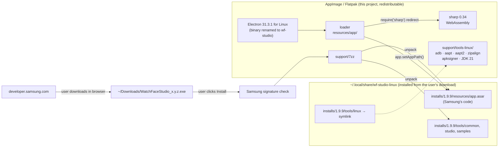
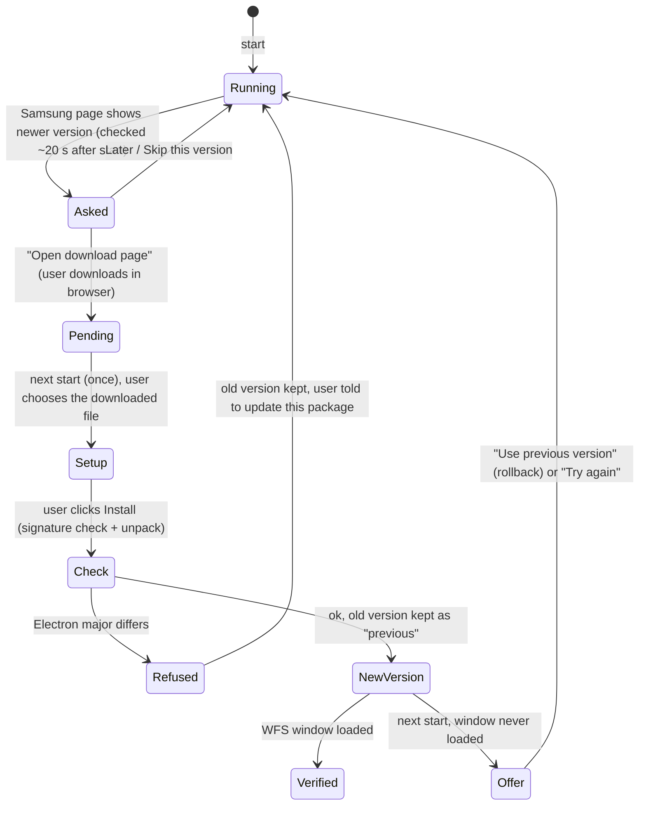

# How WF-Studio for Linux works

This document explains how WF-Studio for Linux runs Samsung's Galaxy Watch Face Studio (WFS)
natively on Linux, what it changes and what it doesn't, and how updates, packaging and
releases work. It is written for curious users and for contributors.

- [The key idea](#the-key-idea)
- [What is inside the Windows installer](#what-is-inside-the-windows-installer)
- [Architecture](#architecture)
- [First start: installation](#first-start-installation)
- [Every start: launching WFS](#every-start-launching-wfs)
- [Linux-specific fixes](#linux-specific-fixes)
- [Updates and rollback](#updates-and-rollback)
- [Packaging: bundle, AppImage, Flatpak](#packaging-bundle-appimage-flatpak)
- [Files and directories](#files-and-directories)
- [Security and legal notes](#security-and-legal-notes)
- [Releasing](#releasing)
- [Maintenance: when Samsung releases a new version](#maintenance-when-samsung-releases-a-new-version)

## The key idea

Watch Face Studio is an [Electron](https://www.electronjs.org/) application: its user interface
and logic are JavaScript running on Chromium + Node.js. The Windows and macOS versions ship the
**same JavaScript code** (`resources/app.asar`) on a platform-specific Electron runtime. The code
even already contains a branch for Linux:

```js
// from WFS' build/Commands.js (minified in the original)
const platformDir = process.platform === "linux" ? "linux"
                  : process.platform === "darwin" ? (arm64 ? "mac_arm64" : "mac")
                  : "window";
const adbPath = join(getApplicationPath(), "tools", platformDir, "adb" + ext);
```

So instead of emulating Windows (Wine), WF-Studio for Linux runs Samsung's unchanged
`app.asar` on **Electron for Linux** and supplies native Linux versions of the few
platform-specific parts. No Samsung file is modified.

## What is inside the Windows installer

`WatchFaceStudio_x.y.z.exe` is an NSIS installer created by electron-builder. Inside is
`$PLUGINSDIR/app-64.7z`, which contains the installed application:

| Path | Size | Platform-specific | Used on Linux? |
| --- | --- | --- | --- |
| `resources/app.asar` | ~160 MB | no (JavaScript, HTML, CSS) | **yes, unchanged** |
| `resources/app.asar.unpacked/` | fonts, `sharp` | fonts no, `sharp-win32-x64.node` yes | fonts yes; sharp replaced by its WebAssembly build |
| `tools/common/` | bundletool, android.jar, keys | no (Java/data) | **yes, unchanged** |
| `tools/studio/`, `tools/wfs_samples/` | templates, samples | no | **yes, unchanged** |
| `WatchFaceStudio.exe` + DLLs, `locales/`, `*.pak` | ~240 MB | yes (Electron 31.3.1 for Windows) | no, replaced by Electron for Linux |
| `tools/window/` | ~335 MB | yes (adb.exe, aapt.exe, aapt2.exe, zipalign.exe, apksigner.bat, JDK 21) | no, replaced by native tools |

## Architecture



Components:

| Component | Source | Why |
| --- | --- | --- |
| Electron 31.3.1 (Linux x64) | electron/electron releases | Same version WFS 1.9.9 was built with (`Electron/31.3.1` in `WatchFaceStudio.exe`). |
| Loader (`loader/`) | this repo | Setup UI, signature check, installer, launcher, update logic. |
| sharp 0.34.5 + `@img/sharp-wasm32` | npm registry via pnpm | WFS' image processing; the Windows build ships a `.node` for win32 only. Runs as **WebAssembly**, see [Why sharp runs as WebAssembly](#why-sharp-runs-as-webassembly). |
| Android SDK Build-Tools 34 | dl.google.com | `aapt`, `aapt2`, `zipalign`, `apksigner` (WFS targets android-34). |
| Android SDK Platform-Tools 35.0.2 | dl.google.com | `adb` for Run on Device. |
| Eclipse Temurin JDK 21 (jlink-trimmed) | Adoptium | `java` (bundletool, apksigner), `keytool`, `jarsigner`. WFS ships Oracle JDK 21 on Windows. |
| 7-Zip 24.08 | ip7z/7zip | Unpacks Samsung's NSIS installer. |

All are pinned by URL and sha256 in [`deps.env`](../deps.env) and verified at build time by
`scripts/fetch-deps.sh`.

## First start: installation

WF-Studio for Linux **never downloads Samsung software by itself.** The loader
(`loader/main.js`) finds no installed WFS and opens the setup window (`loader/setup/`):

1. **Version hint.** `installer.fetchReleaseInfo()` reads
   `https://developer.samsung.com/watch-face-studio/download.html` and parses only the version
   of the Windows build, to show "Latest from Samsung". If this fails (offline), setup still
   works.
2. **User downloads.** **Open Samsung download page** opens the page in the user's browser. The
   user downloads the Windows installer there and accepts Samsung's license on Samsung's site.
3. **User chooses the file.** The user picks the downloaded `WatchFaceStudio_x.y.z.exe` with
   **Choose installer file…** (a native file dialog that opens in the XDG Downloads folder).
   The app never scans folders or offers files by itself. The path comes from the dialog in the
   main process; the setup window (renderer) cannot pass arbitrary paths.
4. **Signature check.** `lib/authenticode.js` verifies the installer's Authenticode signature
   before anything is unpacked:
   - recomputes the PE image hash and compares it with the signed hash (detects any modified byte);
   - verifies the PKCS#7 signature with the signer certificate;
   - requires a code-signing certificate issued to **Samsung Electronics Co., Ltd.** that
     chains to a root in Node's built-in Mozilla trust store (currently *DigiCert Trusted
     Root G4*).

   Revocation and expiry are not checked (signatures are timestamped). The check can be
   bypassed only with `WFS_LINUX_SKIP_SIGNATURE_CHECK=1`, which is not recommended.
5. **Unpack.** `installer.installFromExe()`:
   - extracts `$PLUGINSDIR/app-64.7z` from the `.exe` with 7-Zip;
   - **compatibility check:** streams `WatchFaceStudio.exe` out of the archive (never written to
     disk) and reads its `Electron/x.y.z` string; if its major version differs from the bundled
     Electron, installation stops (see [Updates](#updates-and-rollback));
   - extracts only `resources/`, `tools/` and the license texts, leaving out `tools/window` and
     all Windows binaries (≈270 MB instead of ≈700 MB);
   - reads the WFS version from `package.json` inside `app.asar`;
   - moves the result to `installs/<version>/` and records it, including the verified
     publisher, in `state.json`.
6. **Start.** WFS is started in the same process (see next section). The downloaded `.exe` is
   left where the user put it.

`--wfs-install-from=<file.exe>` runs steps 4–6 without the window (same signature check).

## Every start: launching WFS

**Order of events** (`loader/main.js`):

1. **Single instance.** The loader takes Electron's single-instance lock. A second start (menu
   entry, `.wfs` file, `--wfs-settings`) is handed to the running instance: `--wfs-settings` opens
   the settings window there, even while WFS runs (the argument is rewritten so WFS' own
   `second-instance` handler only focuses its window). WFS' own `requestSingleInstanceLock()`
   later succeeds because the process already holds the lock.
2. **Display switches** from `settings.json` (or environment variables) are applied before
   Electron's `ready` event, which is the only time Chromium reads them.
3. **Boot screen** (`loader/boot/`, unless switched off): checks that the bundled tools exist,
   runs the update checks (`lib/updates.js`, 3 s timeout each, only version numbers), and starts
   WFS after 2 s unless the user interacts or an update/problem is shown. Without the boot screen
   WFS is started before `ready` and the update check runs 20 s later in the background.
4. **WF-Studio Settings** (`loader/settings/`) run in the same process. Changes that need a
   restart (display, reset, installing another version while WFS runs) go through
   `lib/relaunch.js`: it starts the package launcher (`WFS_LINUX_LAUNCHER`, exported by the
   AppImage's AppRun and the Flatpak wrapper, so the AppImage is re-mounted and zypak is used)
   as a detached process with `--wfs-relaunched`, and exits. The new instance waits up to 5 s
   for the old one to release the single-instance lock.

`loader/lib/launch.js` turns the Linux Electron process into Watch Face Studio:

1. **Tools.** `installs/<version>/tools/linux` is (re-)linked to the bundle's
   `support/tools-linux`. It is refreshed on each start because an AppImage is mounted at a
   different path every time.
2. **Environment.** `JAVA_HOME` and `PATH` point at the bundled JDK, which the Linux `apksigner`
   script needs.
3. **Native module.** `Module._resolveFilename` is wrapped so that `require('sharp')` from WFS
   code resolves to the bundled WebAssembly build of sharp instead of the Windows one inside
   `app.asar.unpacked`.
4. **Command line and working directory** are normalised (see below).
5. **Hand-over.** Like Electron's own `default_app`, the loader calls `app.setVersion()`,
   `app.setAppPath(<install>/resources/app.asar)` and loads WFS' `main` script with
   `Module._load(…, true)`. From here on WFS behaves exactly as if it had been started by its
   own executable: `app.getAppPath()` points into its `app.asar`, its
   `getApplicationPath()` (`appPath/../..`) resolves to the install directory with `tools/`,
   and `app.isPackaged` is `true` because the Electron binary is not named `electron`.

When the boot screen, setup or settings ran first, Electron's `ready` event has already fired;
the loader re-emits it so WFS' `app.on('ready')` handler runs.

The Electron app name comes from the loader's `package.json` (`productName: "WatchFaceStudio"`),
so WFS' settings live in `~/.config/WatchFaceStudio`, its normal location.

## Linux-specific fixes

Samsung's code makes a few assumptions that only hold on Windows or macOS. The loader
works around them without patching WFS:

| Assumption in WFS | Effect on Linux | Fix in the loader |
| --- | --- | --- |
| `process.argv[1]` is a project file (Windows double-click convention) | AppImage passes `--no-sandbox` → "Invalid project file" on every start | `process.argv` is reduced to `[exe]` or `[exe, file.wfs]`. |
| Second instance: `argv[2]` is the file or `--source-shortcut=…` | `extname(undefined)` would throw | A `second-instance` listener registered before WFS' own rewrites `argv` in place. |
| Custom `file://` handler strips `file:///` → relative path | Works on macOS only because Finder starts apps with cwd `/` | `process.chdir('/')` before WFS starts. |
| `sharp-win32-x64.node` | not loadable | require redirect to sharp's WebAssembly build. |
| `tools/linux/*` exists | missing in the Windows payload | symlink to bundled native tools. |

### Why sharp runs as WebAssembly

sharp's native Linux builds bundle libvips **with its own copy of GLib**, and export those GLib
symbols. Electron links GTK, so the system GLib is always loaded first (even in
`ELECTRON_RUN_AS_NODE` mode). The dynamic linker then resolves part of libvips' GLib calls to the
system copy: two half-mixed GLib type systems. Depending on the GLib version this ranges from
`GLib-GObject-CRITICAL` warnings (Ubuntu 24.04) to an abort with
`VIPS_IS_OBJECT( vobject )` assertion failures (openSUSE Tumbleweed). Loading the addon with
`RTLD_DEEPBIND` only turns this into a `double free` (Chromium's allocator shim), and newer native
sharp releases export the same symbols.

sharp's **WebAssembly build** (`@img/sharp-wasm32`, sharp ≥ 0.33) has no native symbols at all,
needs no install script, and supports everything WFS uses (`metadata`, `rotate`, `resize`, `png`,
`raw`, `trim`, `composite` with SVG masks, `withMetadata`, `toFile`/`toBuffer`). It is pinned to
sharp 0.34.5 in `loader/package.json`; `loader/pnpm-workspace.yaml` restricts installation to the
wasm32 variant, and `scripts/build-bundle.sh` fails if a native sharp build ends up in the bundle.

## Updates and rollback

**Watch Face Studio (Samsung)** has no auto-update on any platform. WF-Studio for Linux adds an
update *notification*. Downloading stays a user action:



- `state.json` keeps `current` and `previous` installs. `current.launchAttempts` is increased
  before WFS starts and reset, together with `verified: true`, once WFS' first window has
  loaded. If the next start finds `verified: false` and `launchAttempts > 0` (a crash or hang
  right after an update), it offers to go back.
- Only one previous version is kept (~270 MB). `--wfs-rollback`, or the button in the setup
  window, switches manually. A rolled-back version is not offered as an update again until a
  newer one appears.

**WF-Studio for Linux itself** (`loader/lib/selfupdate.js`) checks the latest GitHub release and
tells the user how to update:

- **Flatpak** installed from the project's repository (GitHub Pages) updates through
  `flatpak update` / the software centre.
- **AppImage** embeds update information
  (`gh-releases-zsync|kirnbauer|wf-studio-linux|latest|WF-Studio-Linux-*-x86_64.AppImage.zsync`);
  AppImageUpdate and Gear Lever use the `.zsync` file from the release for delta updates.

## Packaging: bundle, AppImage, Flatpak

`scripts/build-bundle.sh` assembles a distribution-neutral directory, then both packages wrap it:

```
build/wf-studio-linux/
  wf-studio                  Electron binary (renamed → app.isPackaged = true)
  resources/app/             loader + node_modules/sharp (WebAssembly)
  support/7zz
  support/tools-linux/       aapt aapt2 zipalign apksigner lib/apksigner.jar lib64/libc++.so adb jdk/
  LICENSES/                  Electron, Chromium, Android tools, JDK, 7-Zip, this project
```

The build ends with a self-test (`lib/check.js`, run via `ELECTRON_RUN_AS_NODE`) that executes
every tool and processes an image with sharp.

| | AppImage | Flatpak |
| --- | --- | --- |
| Script | `scripts/build-appimage.sh` | `scripts/build-flatpak.sh`, manifest `flatpak/dev.kirnbauer.WFStudioLinux.yml` |
| Install location | inside the AppImage | `/app/lib/wf-studio-linux` |
| Base | none (glibc of the host) | `org.freedesktop.Platform 26.08` + `org.electronjs.Electron2.BaseApp` |
| Chromium sandbox | off (`--no-sandbox`): a setuid helper can't run from a FUSE mount | on, via zypak |
| WFS data | `~/.local/share/wf-studio-linux` | `~/.var/app/dev.kirnbauer.WFStudioLinux/data/wf-studio-linux` |
| Permissions | — | network (download, adb over Wi-Fi), `--device=all` (adb over USB), `--filesystem=home` (workspace), X11/Wayland, DRI |
| Updates | zsync (AppImageUpdate / Gear Lever) | OSTree repo on GitHub Pages |

No browser needs to be installed for any package: Electron brings its own Chromium. A browser of
any kind is only used to download the installer from Samsung's page.

## Files and directories

| Path | Content |
| --- | --- |
| `~/.local/share/wf-studio-linux/state.json` | current/previous install, update flags |
| `~/.local/share/wf-studio-linux/installs/<version>/` | unpacked Watch Face Studio |
| `~/.local/share/wf-studio-linux/settings.json` | WF-Studio Settings (boot screen, display, update checks) |
| `~/.local/share/applications/dev.kirnbauer.WFStudioLinux*.desktop`, icon and MIME file under `~/.local/share/` | start-menu entries created from the settings (AppImage/bundle only) |
| `~/Desktop/dev.kirnbauer.WFStudioLinux.desktop` (XDG desktop folder) | desktop shortcut created from the settings |
| `~/.config/WatchFaceStudio/` | WFS settings, logs, plugins (WFS' own) |
| `~/WatchFaceStudio/` | default workspace (WFS' own) |

## Security and legal notes

- Nothing from Samsung is redistributed, and the app never downloads executables by itself. The
  user downloads WFS from `developer.samsung.com` in their browser and accepts Samsung's license
  there; installing always requires a click.
- Every installer must carry a valid Authenticode signature by Samsung Electronics Co., Ltd.
  (see [First start](#first-start-installation)) before it is unpacked. This protects against
  manipulated, corrupted or look-alike files.
- All bundled third-party binaries are pinned by sha256.
- Network access by the loader itself is limited to reading Samsung's download page (version
  number) and the GitHub releases API (new WF-Studio for Linux version); both can be switched
  off in WF-Studio Settings, and `WFS_LINUX_NO_UPDATE_CHECK=1` turns both off.
- The AppImage disables the Chromium sandbox; WFS loads only local content (its own UI and the
  user's projects). The Flatpak keeps the sandbox and runs inside Flatpak's own sandbox.
- The Flatpak repository is GPG-signed in CI (commit and summary) with a dedicated key stored as a
  repository secret; the public key is embedded in the `.flatpakrepo`/`.flatpakref` files, so
  clients verify every update. See [docs/RELEASING.md](RELEASING.md).
- The Flatpak keeps `--filesystem=home` (projects can live anywhere) and `--device=all` (adb over
  USB). A vendor filter such as
  `--usb=vnd:04e8` (Samsung) would lock out Wear OS watches from other vendors, so it is not used.

## Releasing

CI (`.github/workflows/build.yml`) runs on every push:

1. **Bundle + AppImage:** builds the bundle (with self-test) and the AppImage + `.zsync`, then
   smoke-tests the AppImage with `--wfs-check` under Xvfb.
2. **Flatpak:** builds the Flatpak from the bundle in the Flathub build container.

For a release:

1. Bump `version` in `loader/package.json` and add a `<release>` entry to
   `packaging/dev.kirnbauer.WFStudioLinux.metainfo.xml`.
2. Push a tag `v<version>`. CI then additionally:
   - creates a **draft GitHub release** with the AppImage, `.zsync`, `.flatpak` and the bundle
     tarball (publish it after checking);
   - publishes the **Flatpak repository** to GitHub Pages.

One-time setup for GitHub Pages: *Settings → Pages → Build and deployment → Source: GitHub
Actions*.


**App ID.** The Flatpak/AppStream ID is `dev.kirnbauer.WFStudioLinux` (reverse DNS of the
maintainer's domain `kirnbauer.dev`). It must never change after the first release: Flatpak keeps
user data under `~/.var/app/<app-id>`, so a new ID means a different app for users. Hosting
(releases, the Flatpak repo on GitHub Pages) is independent of the ID.

**Not on Flathub.** The Flatpak is deliberately distributed only through this project's own
repository on GitHub Pages and as a `.flatpak` file in the releases, not through Flathub. (Flathub
would also require a disclosure of AI-generated code and packaging under its Generative AI
policy; large parts of this project were written with AI assistance.) The Flathub remote is only
used for the runtimes (`org.freedesktop.Platform`, `org.electronjs.Electron2.BaseApp`).

## Maintenance: when Samsung releases a new version

Usually nothing needs to be done: users get the new WFS through the built-in updater. Check:

1. **Electron version:** `strings WatchFaceStudio.exe | grep -m1 Electron/`. If the major version
   changed, update `ELECTRON_URL`/`ELECTRON_SHA256` in `deps.env` (SHASUMS256.txt of the Electron
   release) and release a new WF-Studio for Linux. Until then, the updater refuses the new WFS
   and keeps the working version.
2. **Native modules:** list `resources/app.asar.unpacked/node_modules/**/*.node`. Today only
   `sharp` is native, and it is replaced by sharp's WebAssembly build. If Samsung updates sharp
   (check that its API use still works with the bundled version) or adds another native module,
   add a replacement
   to `loader/package.json` and the redirect in `launch.js`.
3. **Tools:** if WFS starts targeting a newer Android API, update the Build-Tools in `deps.env`.
4. **Download page:** if `parseDownloadPage()` stops finding the version, adjust the parser
   (`loader/lib/installer.js`). Only the version hint is affected; installing still works.
5. **Signature:** if Samsung changes the publisher name of its code-signing certificate, update
   `EXPECTED_PUBLISHER` in `loader/lib/authenticode.js`.
6. Test: install with `--wfs-install-from=…`, open a sample, run **Publish** and check the `.aab`
   (`bundletool validate`).
